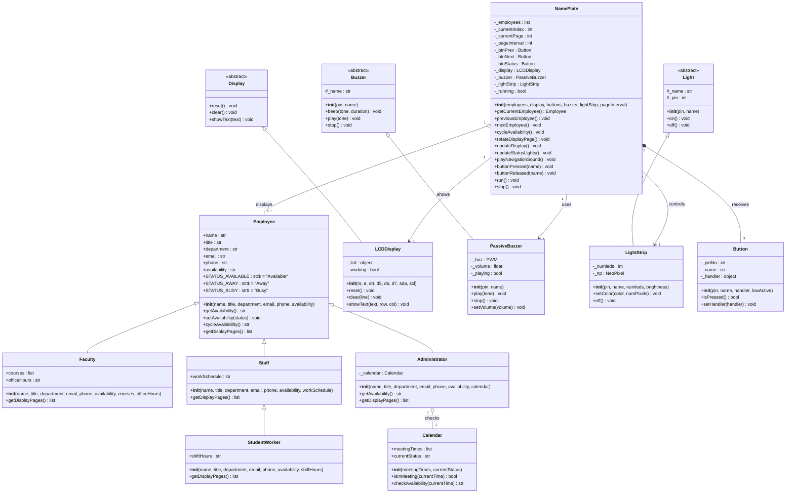

# Employee NamePlate Application - Implementation Plan & Architecture

This document outlines the architecture, hardware integration, class responsibilities, and implementation details for the **Employee NamePlate** MicroPython application built for the Raspberry Pi Pico using the `PicoLibrary` framework.

---

## 1. Executive Summary

The **Employee NamePlate** is an interactive physical computing application designed for Raspberry Pi Pico microcontrollers running MicroPython. It turns an LCD screen into a dynamic desk or office nameplate displaying employee profile details (name, title, department, contact information, schedules, and courses). 

Users interact with the nameplate using three tactile push buttons:
1. **Previous Button (`btn_prev`)**: Navigates backwards through the registered employees.
2. **Next Button (`btn_next`)**: Navigates forwards through the registered employees.
3. **Status Button (`btn_status`)**: Cycles the selected employee's availability status between **Available**, **Away**, and **Busy**.

Hardware outputs provide multi-sensory feedback:
* **1602 LCD Display**: Shows multi-page employee information, automatically rotating pages at fixed intervals without screen flicker.
* **16-LED NeoPixel Light Strip**: Dynamically color-codes availability (🟢 Green = Available, 🟡 Yellow = Away, 🔴 Red = Busy).
* **Passive Buzzer**: Emits audio cues (800 Hz chirp for navigation, 1200 Hz chime for status updates).

---

## 2. Hardware Architecture & Pin Mapping

The physical system integrates standard sensors and actuators connected to the Raspberry Pi Pico (RP2040) GPIO pins:

| Hardware Component | PicoLibrary Class | Interface / GPIO Pin | Description |
| :--- | :--- | :--- | :--- |
| **I2C 1602 LCD Display** | `LCDDisplay` | **GP0 (SDA), GP1 (SCL)** | 2-line $\times$ 16-character alphanumeric screen for text pages. |
| **NeoPixel Light Strip** | `LightStrip` | **GP2 (Data)** | 16-LED WS2812B NeoPixel strip for status color indication. |
| **Previous Button** | `Button` | **GP10** | Tactile push button (Active-Low with internal pull-up) for navigating to the previous employee. |
| **Next Button** | `Button` | **GP11** | Tactile push button (Active-Low with internal pull-up) for navigating to the next employee. |
| **Status Button** | `Button` | **GP12** | Tactile push button (Active-Low with internal pull-up) for cycling availability. |
| **Passive Buzzer** | `PassiveBuzzer` | **GP15 (PWM)** | Piezo buzzer driven by pulse-width modulation for auditory feedback. |

---

## 3. Project Directory Structure

```text
PicoLibrary/
├── Calendar.py             # Meeting schedule manager and availability evaluator
├── Employee.py             # Employee domain hierarchy (Employee, Faculty, Staff, StudentWorker, Administrator)
├── NamePlate.py            # Main application controller and hardware coordinator
├── main.py                 # System entry point: hardware initialization, profile creation, and execution loop
│
├── Button.py               # PicoLibrary: Hardware interrupt-driven button driver
├── Buzzer.py               # PicoLibrary: Active and Passive PWM buzzer abstractions
├── Displays.py             # PicoLibrary: Text-based display base and LCDDisplay (I2C/Parallel)
├── Lights.py               # PicoLibrary: Digital/PWM lights and standard RGB color tuples
├── LightStrip.py           # PicoLibrary: NeoPixel strip animations and color controls
└── Log.py                  # PicoLibrary: Centralized logging utility
```

---

## 4. UML Class Diagram

The following Mermaid class diagram illustrates the object-oriented structure, class hierarchies, and associations according to the system design:



---

## 5. Class Responsibilities & Implementation Details

### 5.1 Calendar (`Calendar.py`)
* **Purpose**: Tracks scheduled meeting times and determines whether an employee is currently occupied.
* **Attributes**:
  * `meetingTimes`: List of meeting intervals represented as string tuples (e.g., `[("09:00", "11:00"), ("14:00", "15:30")]`).
  * `currentStatus`: Default availability when outside meeting windows (defaults to `"Available"`).
* **Key Methods**:
  * `isInMeeting(currentTime=None)`: Checks if a given time string (or local time obtained from `time.localtime()`) falls within any `(start, end)` tuple.
  * `checkAvailability(currentTime=None)`: Returns `"Busy"` if `isInMeeting` is `True`; otherwise returns `currentStatus`.

### 5.2 Employee Hierarchy (`Employee.py`)
* **`Employee` (Base Class)**:
  * Encapsulates common attributes: `name`, `title`, `department`, `email`, `phone`, and `availability`.
  * Class constants: `STATUS_AVAILABLE = "Available"`, `STATUS_AWAY = "Away"`, `STATUS_BUSY = "Busy"`.
  * `cycleAvailability()`: Transitions through the circular sequence: `Available -> Away -> Busy -> Available`.
  * `getDisplayPages()`: Formats attributes into 2-line tuples (`(line1, line2)`) conforming to 16-character LCD limits.
* **`Faculty`**:
  * Inherits from `Employee`.
  * Adds `courses` (list of course codes) and `officeHours` (string).
  * Polymorphically extends `getDisplayPages()` to show office hours and active courses on subsequent pages.
* **`Staff`**:
  * Inherits from `Employee`.
  * Adds `workSchedule` (e.g., `"8AM-4:30PM M-F"`).
  * Extends `getDisplayPages()` to display regular working hours.
* **`StudentWorker`**:
  * Inherits from `Staff`.
  * Specializes `workSchedule` into `shiftHours` (e.g., `"Tue/Thu 1-5PM"`).
* **`Administrator`**:
  * Inherits from `Employee`.
  * Associates with a `Calendar` instance.
  * Overrides `getAvailability()` to evaluate `self._calendar.checkAvailability()`, dynamically marking the administrator as `"Busy"` during meetings.
  * Extends `getDisplayPages()` to show calendar status.

### 5.3 Controller (`NamePlate.py`)
* **Purpose**: Coordinates hardware inputs and outputs, manages the currently displayed employee index and page rotation.
* **Attributes**:
  * `_employees`: List of `Employee` instances.
  * `_currentIndex`: Index of the currently displayed employee.
  * `_currentPage`: Index of the active display page for the current employee.
  * `_pageInterval`: Rotation period in seconds (default: 3 seconds).
  * Hardware references: `_btnPrev`, `_btnNext`, `_btnStatus`, `_display`, `_buzzer`, `_lightStrip`.
* **Button Handling**:
  * Adheres to the `PicoLibrary` `Button` contract: `buttonPressed(name)` and `buttonReleased(name)`.
  * Maps `btn_prev` $\rightarrow$ `previousEmployee()`
  * Maps `btn_next` $\rightarrow$ `nextEmployee()`
  * Maps `btn_status` $\rightarrow$ `cycleAvailability()`
* **Display & Visual Strategy**:
  * Anti-flicker LCD updates: Each string is padded to 16 characters (`f"{line[:16]:<16}"`) before writing to the row. This overwrites previous characters immediately without requiring a full screen clear.
  * Status lighting: Maps `Employee.STATUS_AVAILABLE` to `GREEN`, `STATUS_AWAY` to `YELLOW`, and `STATUS_BUSY` to `RED`.
* **Audio Feedback**:
  * Navigation chirp: 800 Hz for 60 ms.
  * Status change confirmation: 1200 Hz for 100 ms.
* **Execution Loop (`run`)**:
  * Uses `time.ticks_ms()` and `time.ticks_diff()` to execute non-blocking page rotation while remaining responsive to button interrupts.
  * Safely cleans up hardware outputs (`stop()`) upon termination.

### 5.4 Application Entrypoint (`main.py`)
* Initializes hardware components with graceful fallbacks (e.g., parallel LCD fallback if I2C fails).
* Instantiates diverse employee profiles:
  * `Faculty`: Dr. Ada Lovelace
  * `Staff`: Grace Hopper
  * `StudentWorker`: Alan Turing
  * `Administrator`: Dr. Katherine Johnson (linked with a scheduled `Calendar`)
* Connects hardware to `NamePlate` and launches the event loop.
* Provides a mock desktop simulation fallback when run outside a MicroPython environment.

---

## 6. Verification and Testing Strategy

Each class file includes an isolated, runnable `if __name__ == "__main__":` test block using `Log.i()` to verify its functionality independently:

1. **`Calendar.py` Self-Test**:
   * Evaluates scheduled meeting time ranges against edge times.
   * Confirms `isInMeeting()` and `checkAvailability()` return `"Busy"` during meetings and `"Available"` outside.
2. **`Employee.py` Self-Test**:
   * Verifies status cycling across all availability states.
   * Asserts correct polymorphic behavior and display page layouts for `Faculty`, `Staff`, `StudentWorker`, and `Administrator`.
3. **`NamePlate.py` Self-Test**:
   * Employs mock display, buzzer, light strip, and button classes.
   * Validates navigation index wrapping, page rotation, button event dispatching, and hardware output commands.
4. **`main.py` Integration Test**:
   * Runs an automated end-to-end simulation executing navigation, page rotation, and status cycling.

---

## 7. How to Run the Application

### A. On Raspberry Pi Pico (MicroPython)
1. Connect the Raspberry Pi Pico via USB and open **Thonny IDE**.
2. Upload all project files (`Calendar.py`, `Employee.py`, `NamePlate.py`, `main.py`, and the existing `PicoLibrary` files) to the root directory of the Pico.
3. Wire the physical hardware to the designated GPIO pins as defined in Section 2.
4. Execute `main.py` in Thonny, or power-cycle the Pico to run standalone.

### B. On Desktop (Simulation & Self-Tests)
To run the automated tests locally:
```powershell
python Calendar.py
python Employee.py
python NamePlate.py
python main.py
```
